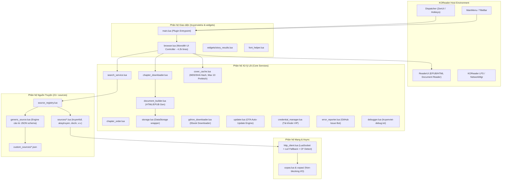
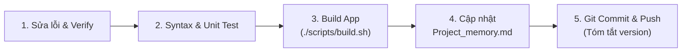

# Project Memory: Z-Truyenviet.koplugin

Tài liệu lưu trữ bộ nhớ dự án, tổng hợp kiến trúc, tình trạng kỹ thuật hiện tại, danh mục nguồn truyện, các bài học kinh nghiệm qua các phiên bản và quy trình vận hành/phát triển cho plugin **Truyện Việt** trên hệ điều hành **KOReader**.

---

## 1. Thông tin chung & Tình trạng phiên bản

| Thuộc tính | Chi tiết |
| :--- | :--- |
| **Tên Plugin** | `truyenviet` (Hiển thị: *Truyện Việt*) |
| **Mục tiêu** | Tìm kiếm, duyệt danh mục, tải về và đọc truyện chữ / truyện tranh trực tiếp từ các website truyện Việt Nam trên máy đọc sách chạy KOReader (Kindle, Kobo, Android, v.v.). |
| **Phiên bản hiện tại** | Codebase: `v3.18.3` (`BUILD-1395`) |
| **Ngôn ngữ & Runtime** | LuaJIT (tương thích môi trường Lua 5.1/LuaJIT của KOReader) |
| **Async Engine** | Copas 4.x + LuaSocket + Timerwheel + Binaryheap |
| **Kho lưu trữ Git** | `https://github.com/magicxlll/Z-Truyenviet.koplugin.git` (nhánh `main`) |
| **Build Artifact** | `dist/truyenviet.koplugin.zip` |

---

## 2. Kiến trúc Hệ thống (System Architecture)



### Bản đồ Module và Trách nhiệm:

1. **`main.lua`**: Điểm vào của plugin, đăng ký menu KOReader, nút topbar, và các hành động Dispatcher (`start_truyenviet`, `truyenviet_continue`, `truyenviet_history`, `truyenviet_downloaded`, v.v.). Tương thích ZenUI thông qua gán `plugin = true`.
2. **`truyenviet/browser.lua`**: Controller giao diện trung tâm điều hướng tất cả menu (duyệt nguồn, tìm kiếm, xem chi tiết truyện, chọn chương, tải chương, lịch sử, cài đặt). Hiện tại là module nguyên khối lớn (>4,200 dòng).
3. **`truyenviet/http_client.lua`**: Quản lý request HTTP/HTTPS với cơ chế fallback kép:
   - Thử `socket.http` nội tại.
   - Nếu gặp SSL khắt khe hoặc handshake lỗi, tự động chuyển sang gọi lệnh CLI `curl -skSL` ở tầng OS.
   - Nhận diện màn hình xác thực Cloudflare Challenge.
4. **`truyenviet/source_registry.lua`**: Đăng ký và nạp các nguồn truyện tích hợp sẵn và tải động các nguồn từ thư mục `custom_sources/*.json`.
5. **`truyenviet/chapter_downloader.lua`**: Quản lý tiến trình tải chương đồng bộ hoặc bất đồng bộ qua Copas, tránh nghẽn UI của máy đọc sách.
6. **`truyenviet/document_builder.lua`**: Dựng file đọc dạng HTML/EPUB lưu trữ cục bộ cho KOReader mở, tích hợp làm sạch CSS và lọc quảng cáo.
7. **`truyenviet/credential_manager.lua`**: Quản lý tài khoản đăng nhập (VIP) của các nguồn yêu cầu xác thực (AkayTruyen, TVE-4U).
8. **`truyenviet/storage.lua`**: Đọc/ghi cấu hình và trạng thái qua `datastorage` của KOReader.

---

## 3. Danh mục 21+ Nguồn truyện (Source Catalog)

| ID | Tên Nguồn | Tên miền mặc định | Loại | Kỹ thuật cào | Ghi chú đặc biệt |
| :--- | :--- | :--- | :--- | :--- | :--- |
| `truyenfull` | Truyện Full | `https://truyenfull.io` | Text | HTML Regex | Nguồn phổ biến, hỗ trợ pagination regex |
| `truyenqq` | Truyện QQ | `https://truyenqqto.com` | Comic | HTML Regex | Truyện tranh, cào danh sách ảnh chương |
| `dualeo` | Dưa Leo Truyện | `https://dualeotruyen5.com` | Comic | HTML Regex | Truyện tranh |
| `truyendich` | Truyện Dịch | `https://truyendich.space` | Text | JSON API + HTML | Tìm kiếm qua `/api/novels/search` (HTML render phía client); `.ai`/`.fit` bị chặn TLS từ VN nên dùng `.space`, URL cũ tự đổi |
| `cbunu` | Cbunu | `https://cucbongunu.com` | Text | HTML + Session | Cần quản lý Set-Cookie trang chủ |
| `haccbl` | Hắc Cbl | `https://haccbl.top` | Text | HTML + AES/PBKDF2 | Giải mã nội dung chương mã hóa JS |
| `giatocvuongtai` | Gia Tộc Vương Tài | `https://giatocvuongtai.com` | Text | JSON/HTML | Parse JSON metadata |
| `docln` | Cổng Light Novel | `https://docln.net` | Text | HTML Regex + RateLimit | Giới hạn 1.2s/request chống chặn IP |
| `tve4u` | TVE-4U | `https://tve-4u.org` | Forum | XenForo API/HTML | Diễn đàn ebook, yêu cầu đăng nhập |
| `dilib` | DiLib | `https://dilib.vn` | Text | REST/HTML | Hỗ trợ phân trang và tìm kiếm |
| `mizzya` | Mizzya | `https://mizzya.com` | Text | HTML Regex | Nguồn truyện nhẹ |
| `metruyenvn` | Mê Truyện VN | `https://metruyen.net.vn` | Text | HTML Regex | Phân trang và tìm kiếm theo danh mục |
| `aztruyen` | AZ Truyện | `https://aztruyen.com` | Text | HTML Regex | Nhiều danh mục hot/hoàn thành |
| `dualeotruyenfull`| Dưa Leo Full | `https://dualeotruyenfull.net` | Text | initlise JSON + HTML | Tìm kiếm qua `/wp-json/initlise/v1/search` |
| `truyenc` | Truyện C | `https://truyenc.com` | Text | HTML Regex | Cover URL thường chứa khoảng trắng thô |
| `akaytruyen` | Akay Truyện | `https://akaytruyen.com` | Text | AJAX/HTML + VIP Auth | Cache DOM section, endpoint `/search-chapters` |
| `storyaclick` | Story A Click | `https://storyaclick.com` | Text | HTML Regex | Nguồn mới |
| `blhvip` | BLH VIP | `https://api.blhvip.vn` | Text | **REST API (JSON)** | Cào qua REST API backend, nhanh & ổn định |
| `metruyenchuvn` | Mê Truyện Chữ VN | `https://metruyenchu.com.vn` | Text | HTML Regex | Parsing DOM chuẩn |
| `conduongbachu` | Con Đường Bá Chủ | `https://conduongbachu.com` | Text | **WordPress REST API** | `/wp-json/wp/v2/posts`, kiểm tra `X-WP-Total` |
| `xtruyen` | X-Truyện | `https://xtruyen.vn` | Text | **Zlib + Base64 decode** | Giải mã chuỗi mã hóa `data_x` qua `ffi/zlib` |

---

## 4. Các bài học kinh nghiệm xương máu (Lessons Learned)

### 4.1. Ưu tiên REST API ngầm thay vì Regex HTML
- **Bài học:** Cào HTML truyền thống (`string.match`) dễ vỡ khi web đổi layout. Điển hình: `blhvip` dùng REST API (`api.blhvip.vn/v1/...`) và `conduongbachu` dùng WordPress REST API (`wp-json/wp/v2/posts`) giúp code gọn hơn 70%, tốc độ phản hồi nhanh hơn gấp nhiều lần và không bị ảnh hưởng bởi cập nhật CSS.
- **Quy tắc:** Luôn dùng F12 DevTools (Tab Network -> Filter `Fetch/XHR`) trước khi viết regex HTML.

### 4.2. Xử lý phân trang WordPress REST (`X-WP-Total`)
- **Sự cố BUILD-1324:** Khi cào nguồn `conduongbachu`, nếu một trang request giữa chừng bị timeout, plugin lưu bộ đệm mục lục bị cụt khiến người đọc bị mất chương.
- **Giải pháp:** Chỉ công nhận danh mục hoàn thành khi số lượng bài cào được khớp chính xác với header `X-WP-Total` do server trả về.

### 4.3. Cạm bẫy sắp xếp chương: `Natural Compare` vs Số chương thực tế
- **Sự cố:** `helpers.naturalCompare` quy định kiểu `number` đứng trước `string`. Tiêu đề bắt đầu bằng số như `"201: VÔ ĐỀ."` bị đẩy lên đứng trước `"Chương 1: Khởi đầu"`.
- **Bài học:** Khi sắp xếp danh sách chương, nếu cả hai chương đều bóc tách được số hiệu chương (`a.number` và `b.number`), luôn so sánh số học `a.number < b.number` trước; chỉ fallback sang `naturalCompare` trên chuỗi tiêu đề khi không có số chương.

### 4.4. An toàn Coroutine trong LuaJIT
- **Sự cố:** `ChapterDownloader:download` gọi thẳng `coroutine.yield()` để cập nhật thanh tiến trình. Khi chạy trong luồng chính (main thread) hoặc môi trường test đơn vị mà không được bọc bởi coroutine, LuaJIT sẽ văng lỗi nghiêm trọng: `attempt to yield across C-call boundary`.
- **Giải pháp:** Luôn kiểm tra `if coroutine.running() then coroutine.yield(...) end`.

### 4.5. Tác dụng phụ của Monkey-Patching (`helpers.lua`)
- **Sự cố:** `truyenviet/helpers.lua` ghi đè trực tiếp hàm toàn cục `ko_util.urlEncode = Util.urlEncode`. `Util.urlEncode` mã hóa ký tự `@` thành `%40`, làm sai lệch các đoạn mã kiểm thử hoặc module khác kỳ vọng `@` được giữ nguyên.
- **Bài học:** Hạn chế tối đa việc ghi đè module chia sẻ (`ko_util`). Nên gọi trực tiếp `Util.urlEncode` trong các module thuộc phạm vi plugin.

### 4.6. Vấn đề bộ nhớ (RAM) trên máy đọc sách E-ink
- Thiết bị E-ink thường chỉ có 512MB - 1GB RAM, CPU đơn nhân hoặc tiết kiệm điện.
- Việc log chuỗi nhị phân (ảnh bìa raw) vào file text log từng gây lỗi `400 Problems parsing JSON` khi gửi báo lỗi GitHub và tràn RAM.
- Giới hạn ảnh prefetch cover tối đa 10 ảnh (`max_prefetch = 10`), không bao giờ nạp toàn bộ danh mục ảnh cùng lúc.

### 4.7. Cloudflare Challenge & Bảo mật HTTPS
- Môi trường KOReader chạy curl nhúng với cờ `-skSL` để bỏ qua lỗi chứng chỉ SSL cũ trên máy đọc sách cũ.
- Khi gặp Cloudflare JS challenge, bắt buộc nhận diện chuỗi `window._cf_chl_opt` hoặc `id="challenge-error-text"` để báo lỗi rõ ràng cho người dùng thay vì treo vòng lặp vô tận.

### 4.8. Cơ chế Tải Google Drive: Vượt cảnh báo Virus & Magic Bytes
- Đối với file > 25MB, Google Drive không trả trực tiếp file nhị phân mà trả về trang HTML cảnh báo virus (`confirm=...` hoặc `download_warning`).
- **Giải pháp:** Bóc tách token `confirm` từ form HTML hoặc anchor `id="uc-download-link"`, đồng thời lưu trữ và chuyển tiếp `Cookie` (chứa session download) trong request tiếp theo.
- File Google Drive thường không có tên chuẩn trong Content-Disposition: Tận dụng trích xuất tiêu đề từ `<meta property="og:title">` của trang preview `/file/d/{id}/view`, kết hợp kiểm tra Magic Bytes (`%PDF`, `PK\3\4` EPUB/CBZ, `Rar!` CBR, `BOOKMOBI`) để tự động gán đúng định dạng ebook.

### 4.9. Thiết kế Cơ chế Cập nhật OTA An Toàn trên Thiết Bị E-ink
- **Non-blocking / Background Throttle:** Máy đọc sách E-ink khởi động chậm và kết nối Wi-Fi có độ trễ. Kiểm tra OTA phải hoãn sau khởi động 8 giây (`scheduleIn(8)`), kiểm tra `NetworkMgr:isOnline()` và giới hạn tần suất (mặc định tối đa 1 lần/24h) để tránh spam request hoặc lag màn hình.
- **So sánh Phiên bản Ngữ nghĩa (Semantic Versioning):** Không so sánh chuỗi thô (`remote ~= local`), mà bóc tách các thành phần số `major.minor.patch (BUILD-xxxx)` để chỉ kích hoạt thông báo khi phiên bản remote thực sự mới hơn.
- **Xác thực Gói Cập nhật (ZIP Validation):** Kiểm tra kích thước tối thiểu (>10KB) và Magic Bytes (`PK\3\4`) để ngăn chặn việc giải nén nhầm trang lỗi HTML (như 404/500).
- **Restart Signal:** Sau khi giải nén đè vào `plugins/`, kích hoạt khởi động lại KOReader qua `Device:restartKOReader()` hoặc gửi tín hiệu thoát chuẩn `os.exit(85)`.

### 4.10. Khuyết Dấu Tiếng Việt trên FreeType / E-ink & Font Be Vietnam Pro
- **Sự cố:** Font tùy biến cũ `ComicHelvetic-Light.ttf` khi hiển thị tiếng Việt trên KOReader bị khuyết toàn bộ các chữ có dấu phức tạp như `ấ`, `ồ`, `ừ`, `ầ`, `ớ` (chỉ hiển thị khoảng trắng trống trơn, ví dụ: "Tìm trên t  t cả ngu  n", "22 ngu  n").
- **Nguyên nhân kỹ thuật:** Phân tích cấu trúc bảng TrueType (`loca`, `glyf`) của font `ComicHelvetic` cho thấy: các glyphs dấu tiếng Việt là các composite glyph bị hỏng (byte size chỉ 24 bytes, số đường bao `contours = -1` trỏ vào thành phần rỗng). FreeType khi render không tìm thấy tọa độ nét vẽ nên bỏ qua, biến chữ thành khoảng trắng.
- **Giải pháp:** Tích hợp bộ font chuẩn **Be Vietnam Pro** (`BeVietnamPro-Regular.ttf` & `BeVietnamPro-Medium.ttf`). Font này do nhóm thiết kế Việt Nam phát triển chuyên biệt cho dấu thanh tiếng Việt, toàn bộ các glyphs `ấ`, `ồ`, `ừ`, `ầ`, `ớ` đều có đầy đủ đường bao vector chuẩn mực (`contours = 2..4`, size 220-330 bytes). Đồng thời `font_helper.lua` tự động phát hiện và nâng cấp các patch cũ từ ComicHelvetic sang Be Vietnam Pro để người dùng không bị kẹt với font hỏng.

### 4.11. Nguyên lý Khám phá & Đăng ký Plugin của ZenOS Launcher (`xZenLabs/zen-os`)
- **Cơ chế Quét Plugin:** `modules/menu/app_launcher/plugin_scan.lua` của ZenOS tìm kiếm phương thức kích hoạt plugin theo thứ tự:
  1. `LAUNCH_METHODS = { "onShow", "show", "open", "launch", "onOpen" }`
  2. Camel-case method: `"on" .. key:sub(1,1):upper() .. key:sub(2)` (ví dụ: `onTruyenviet`)
  3. `probe_menu_entry(mod, key)` (gọi `mod:addToMainMenu(probe)`) để lấy `entry.callback` (`SENTINEL`) hoặc `entry.sub_item_table` (`SUBMENU`).
- **Thứ tự sắp xếp Unicode UTF-8:** ZenOS sắp xếp danh sách chọn bằng so sánh chuỗi byte thô `table.sort(out, function(a,b) return a.title < b.title end)`. Nếu tiêu đề bắt đầu bằng emoji (ví dụ `🔥` có byte UTF-8 `0xF0 = 240`), tiêu đề sẽ bị đẩy xuống cuối cùng sau chữ 'Z' và trượt khỏi trang đầu tiên của bộ chọn "Choose plugin menu".
- **Giải pháp toàn diện:**
  - Định nghĩa tường minh các phương thức `onShow()`, `show()`, `open()`, `launch()`, `onOpen()`, `onTruyenviet()` trên lớp `TruyenViet` trỏ tới `Browser:showRoot()`.
  - Chuẩn hóa tiêu đề menu và dispatcher action thành `"Truyện Việt"` gọn gàng, giúp ZenOS sắp xếp chính xác dưới chữ **T** (nằm giữa Terminal và Tweak document settings).
  - Đăng ký `self.ui.truyenviet = self` trong `init()` để ZenOS phát hiện cả trên ReaderUI lẫn FileManager.

### 4.12. Tìm kiếm song song với AsyncPool & chương mới nhất (BUILD-1376/1377)
- **Bối cảnh:** Tìm kiếm chạy tuần tự từng nguồn nên tổng thời gian bằng tổng mọi nguồn; một nguồn chết kéo cả lượt tìm.
- **Giải pháp:** `truyenviet/async_pool.lua` chạy task trên Copas với giới hạn đồng thời + hạn chót. Ngoài pool tự bơm `copas.step(0.05)`; trong thread của pool (gọi lồng) chỉ `copas.sleep` (Copas không cho step lồng). Coroutine của Trapper KHÔNG phải thread pool. `HttpClient:request` tự chuyển sang `requestAsync` khi `AsyncPool.inPoolThread()`.
- **Contract nguồn:** gán `story.latest_chapter` (số chương mới nhất site ghi, giữ thập phân), `story.chapter_count` (tổng chính xác, chỉ dùng hiển thị dự phòng "N chương") và `story.completed` từ trang tìm kiếm khi có. Không gán số chương mới nhất vào `chapter_count`; nếu không, khai báo `Source:fetchSearchMeta(story)` (1 request, dùng `Http:get` bình thường). CẤM `copas.step`/`addthread`/vòng concurrency riêng trong nguồn. Nguồn hay 429 đặt `Source.meta_concurrency = 1`.
- **Lưu ý:** nhánh async bỏ qua `force_luasec` và curl (io.popen chặn cả Copas); `SearchService` thử lại tuần tự một lần cho nguồn lỗi TLS.


### 4.13. Tủ truyện gộp truyện trên máy & bìa lớn (BUILD-1378)
- **Mục "Trên máy":** `source_id = "local"`, `url` = đường dẫn tuyệt đối (file hoặc thư mục). Logic trong `truyenviet/local_library.lua`; mọi nhánh trong `browser.lua` phải kiểm tra `LocalLibrary.isLocal(story)` trước khi gọi nguồn online.
- **Gắn thư mục ngoài:** trường `offline_dir` trên bản ghi Tủ truyện. `Storage:getLinkedDir` tra cả Tủ truyện cho story mở từ tìm kiếm/lịch sử; `countOfflineChapters` gộp thư mục plugin + thư mục gắn theo số chương. Thư mục gắn là của người dùng: xóa truyện chỉ xóa thư mục plugin.
- **Nhập (`truyenviet/library_import.lua`):** hàm thuần `collect(ctx)` trả `{items, missing}` để UI xác nhận, `apply(items)` ghi một lần bằng `mergeFavorites`. Khóa chống trùng: `source_id|slug bỏ hậu tố số` (mục local: đường dẫn). Thư mục sách chỉ chứa file sách = một bộ; file cạnh thư mục con = truyện lẻ (giữ nguyên tên file vì thường bắt đầu bằng tác giả).
- **Bìa (`truyenviet/cover_finder.lua`):** WeebCentral `temp.compsci88.com/cover/fallback/<id>.jpg` (bỏ qua tên tiếng Việt, chỉ nhận trùng tên chuẩn hóa) → og:image → `cover_url` → trích trang bìa file (`BookInfo:getCoverImage`). `cover_source_id` cho `CoverCache.download` biết dùng header của nguồn nào. Ứng viên `file://` không tải qua mạng.
- **Làm mới tự động:** `meta_time`/`cover_time` lưu trong bản ghi để hạn 12 giờ; nguồn không có `fetchSearchMeta` không bao giờ bị coi là cũ (tránh làm mới mỗi lần mở). `Storage:listFavorites` trả bản sao — trường hiển thị (`source_name`, `offline_count`, `cover_path`, `local_type`) không được lưu.

---

### 4.14. Xóa truyện khỏi Tủ truyện (BUILD-1379)
- `LocalLibrary.deleteTargets/collectTargets/countFiles/removeStories/isProtected`; `Storage:removeFavorites` (một lần lưu). Phải tính đường dẫn **trước** khi xóa khỏi Tủ truyện vì `getLinkedDir` tra Tủ truyện.
- `browser.lua`: `confirmRemoveStories` (2 lựa chọn + xác nhận lần 2) dùng chung cho `toggleFavorite`, mục "Trên máy" và `Browser:selectFavoritesToRemove` (icon `check` trên thanh tiêu đề Tủ truyện).
- `protectedDirs()`: gốc plugin, `DataStorage:getFullDataDir()`, thư viện sách, `home_dir`, `/sdcard`, `/storage/emulated/0`, `/mnt/onboard`, `/mnt/us`. Spec: `spec/favorite_removal_test.lua`.
- BUILD-1380: bỏ nút "Xóa" trên từng hàng (che dòng phụ "Đã tải X/N"); chỉ còn icon `check` trên thanh tiêu đề và giữ truyện.

### 4.15. Bỏ input tồn đọng sau thao tác chặn UI (BUILD-1380)
- Tìm kiếm/tải trong `withLoading` chạy đồng bộ (tìm mọi nguồn ~15s). Android giữ cú chạm "Tìm" trong hàng đợi, rồi giao nó cho danh sách kết quả vừa hiện → mở nhầm truyện ở vị trí nút. `withLoading` gọi `Device.input:inhibitInputUntil(true)` ngay sau callback (KOReader không có `UIManager:discardEvents`).

### 4.16. Lịch sử mục "Trên máy", dung lượng, icon thiếu glyph (BUILD-1381)
- Mục "Trên máy" mở bằng `openEbookFile` nên không qua `Reader` → không có `saveHistory`. `TruyenViet:onReaderReady` (module plugin trong ReaderUI, không trả true) gọi `LocalLibrary.recordRead(file)`: `findOwner` khớp file với mục `local` (chính file hoặc thư mục cha sâu nhất, coi `/sdcard` ≡ `/storage/emulated/0`), lưu `chapter = { title = tên file, url = đường dẫn }`.
- `Browser:openHistoryItem(item, on_return)`: mục local mở `chapter.url` (hoặc danh sách tập), online vào `loadStoryPage`; dùng cho "Tiếp tục" ở menu gốc, `onTruyenVietContinue`, `onTruyenVietBackToChapters` và Lịch sử đọc.
- `LocalLibrary.sizeOf/formatSize/storySize`; `annotate` gắn `size_bytes` (không lưu) = dung lượng của `collectTargets({story})`, cùng đường dẫn mà "xóa cả file" sẽ xóa. Spec: `spec/local_history_size_test.lua`.
- **Font UI của KOReader** (NotoSans → NotoSansCJKsc → nerdfonts/symbols → FreeSans → FreeSerif) không có emoji màu kiểu 📖🏠🔄…; chúng hiện thành ô vuông. Trước khi thêm ký hiệu mới vào chuỗi UI, kiểm tra cmap của 5 font này (fontTools). Có sẵn: ▶ ☰ ⟲ ⤓ ⌂ ↻ ⌕ ☷ ⧉ ⇅ ✎ ● ✕ ★ ☐ ☑ ⚙ ⚡ ✓ ✗ ✅ ❌ 🆕 🌐 🔥 🔊 🔤 🔝.

### 4.17. Crash Menu khi cột `mandatory` quá dài (BUILD-1382)
- `MenuItem` của KOReader không giới hạn độ rộng `mandatory`: `available_width = content_width - mandatory_w - …`; nếu âm thì `setMaxWidth` → `textwidget.lua:224 makeLine (width must be strictly positive)` → KOReader crash (logcat chỉ còn lỗi FORTIFY "destroyed mutex" khi tắt; phải bắt logcat trực tiếp mới thấy lỗi Lua). Mọi `mandatory` có thể dài (tên chương, tên file, tác giả) phải qua `Util.shorten(text, 24)`.

### 4.18. Mục lục lưu + làm mới nền (BUILD-1383)
- `chapter_cache.lua`: một file `string.buffer` cho mỗi `source|url|page` trong `Storage:getChapterCacheDir()`, lưu kết quả **thô** của `getStoryPage` (thứ tự của nguồn; `ChapterOrder.apply` áp lại lúc mở). `ttl = 600`.
- `background_fetch.lua`: chạy `source:getStoryPage` bằng `ffiutil.runInSubProcess` + pipe, UIManager thăm dò. Một việc một lúc; khác key thì hủy việc cũ (`"cancelled"`). Nguồn sửa `story` tại chỗ nhưng ở tiến trình con → phải chép `result.story` về. Tiến trình con không được đụng UI/settings (các nguồn hiện tại không làm).
- `Browser:loadStoryPage(..., force_refresh)`: có bản lưu thì mở ngay (`refresh_state` = offline/fresh/running); `startRefresh` cập nhật `page_data` tại chỗ và `refreshChapterView` gọi `switchItemTable(nil, items, -1)` nếu view còn hiện. `ListView:onCloseWidget` đặt `_truyenviet_hidden` vì `UIManager:close` trực tiếp không qua `onClose`. `openChapter` tìm chương kề lúc bấm. Spec: `spec/chapter_list_flow_test.lua`.
- "Chỉ xóa chương đã tải": `LocalLibrary.downloadTargets/collectDownloadTargets/removeDownloads`; thư mục gắn ngoài chỉ xóa file trùng `Storage.chapterFileName` của mục lục lưu.

### 4.19. Giữ trang khi quay lại danh sách, bìa Lịch sử (BUILD-1384)
- Quay lại danh sách là tạo `StoryResults` mới, `ListView:init` luôn đặt `show_page = 1`. Truyền `focus_story` (qua `options.focus_story` của `showStories`, tham số thứ 2 của `showFavorites`/`showHistory`); `StoryResults:showStoryPage` đặt `show_page` theo vị trí truyện rồi `_populateItems()`.
- `Storage:saveHistory` lưu bản chụp `favoriteRecord` lúc đọc; bìa tìm sau (`LocalLibrary.findCovers`) chỉ ghi vào Tủ truyện. `showHistory` gọi `LocalLibrary.copyFavoriteCovers(stories, Storage:listFavorites())` để lấy `cover_url/cover_source_id/cover_found/cover_time` của mục Tủ truyện.
- `SourceRegistry` không có nguồn `local`: mọi chỗ chỉ xử lý truyện khi `SourceRegistry:get(id)` trả về nguồn sẽ bỏ sót mục "Trên máy" (BUILD-1385: `showStories` không đọc bìa cho Lịch sử đọc). Kiểm tra thêm `LocalLibrary.isLocal(story)`.

### 4.20. Cờ ngữ cảnh của Dispatcher action (BUILD-1386)
- Trong `Dispatcher:registerAction`, `reader = true` (hoặc `rolling`/`paging`) không chỉ là mục hiển thị: `Dispatcher:isActionEnabled` tắt action khi không có ReaderUI, nên cử chỉ/profile gán action đó im lặng không chạy ở trình duyệt file và Lịch sử. Action dùng được mọi nơi chỉ đặt `general`/`filemanager`. Kiểm tra bằng `spec/dispatcher_actions_test.lua`.

### 4.21. Vị trí chương trên thanh trạng thái (BUILD-1387)
- `truyenviet/chapter_position.lua` tính "Chương X/Y" từ `page_data` (đảo chỉ số khi `chapter_sort = "desc"`) và "Tập X/Y" từ danh sách file thư mục. `Browser:openChapter` / `Browser:openFolderBook` gọi `Reader:setPosition(path, text)` trước khi mở; `Reader` gắn hàm vào `ReaderFooter:addAdditionalFooterContent` chỉ khi file đang mở trùng path (so 2 phần cuối của path vì KOReader có thể dùng `/sdcard` hoặc `/storage/emulated/0`), và gỡ ra khi đóng.

### 4.22. Tự xóa chương cũ (auto purge) xóa toàn bộ chương phía trước
- `triggerPrefetchAndPurge` xóa mọi chương đã tải từ chương đang đọc − `purge_distance` (mặc định 5) về chương 1, bằng `os.remove`, không thể khôi phục. Ngày 2026-10-22 mở chương 412 của Ace of the Diamond đã xóa 413 chương, chỉ còn 5. Người dùng chọn chưa sửa hành vi này.

### 4.23. Mở plugin khi KOReader khởi động (BUILD-1388)
- Profile autoexec "Start" gọi `Dispatcher:execute` ở nextTick, và `UIManager:sendEvent` chỉ giao sự kiện cho cửa sổ trên cùng. Với `start_with = "history"` (hoặc favorites, folder_shortcuts), cửa sổ đó là màn Lịch sử nên `StartTruyenViet` bị bỏ qua. Plugin tự mở bằng tuỳ chọn `open_on_start` trong `settings/truyenviet.lua`: `TruyenViet:openOnStart()` chạy một lần mỗi tiến trình (biến cấp module) và gọi `Browser:showRoot()` ở nextTick. Nếu vừa bật tuỳ chọn này vừa để profile chạy lúc khởi động với `start_with = "filemanager"` thì Truyện Việt mở hai lần; chỉ dùng một trong hai.
- `Reader:positionText` ưu tiên vị trí do `Browser` ghi trước khi mở chương; nếu không có và file nằm trong `<root>/<nguồn>/<truyện>/` thì đếm theo `Storage:getOfflineIndex`.

### 4.24. Chuyển chương khi reader còn mở làm mất phiên đọc (BUILD-1389)
- `Reader:show` khi đang đọc bật `active = true` ngay, rồi ở nextTick mới đóng reader cũ. `onCloseWidget` của reader cũ chạy sau đó, đặt `active = false` (và có thể gọi `on_return_callback` của chương mới). Chương mới chạy với `active = false`, nên hết chương bấm next thì `returnToPlugin` dừng ngay ("early return ... active=false"). Gặp ngày 2026-10-22: mở Darwin Jihen chương 50 khi Ace chương 412 còn mở.
- Sửa: `Reader.session` tăng mỗi lần `Reader:show`; listener của mỗi ReaderUI giữ số phiên lúc tạo, và `onCloseWidget` chỉ tắt phiên / gọi callback quay về nếu số đó còn là phiên hiện tại. Vẫn luôn gỡ nội dung "Chương X/Y" khỏi thanh trạng thái.
- Một phiên Truyện Việt: `truyenviet/windows.lua` ghi nhớ các `ListView` và `StoryResults` đang mở (bảng khoá yếu; `init` ghi, `onCloseWidget` xoá). `Browser:showRoot()` đóng chương của plugin trước nếu `Reader.active` và còn `ReaderUI.instance` (qua `Reader:returnToPlugin`, rồi gọi lại `showRoot`), sau đó `Windows.closeAll()` đóng mọi cửa sổ cũ và bỏ `on_return_callback` của chúng. Thoát KOReader trên Android tắt hẳn tiến trình (log "Tearing down UIManager", PID mới khi mở lại), nên không còn phiên nào chạy ngầm sau khi thoát (xem 4.25 cho trường hợp Exit khi đang đọc chương của plugin).

### 4.25. Exit khi đang đọc chương của plugin không thoát KOReader (BUILD-1390)
- Menu Exit/Restart của KOReader phát sự kiện `Exit`/`Restart`; `DeviceListener` gọi `ReaderMenu:exitOrRestart`, chỉ đóng reader (`ui:onClose()`), không gọi `UIManager:quit()`. KOReader tự thoát khi không còn cửa sổ (log "No dialogs left to show"). `onCloseWidget` của plugin lại hẹn `on_return_callback` mở danh sách chương, nên KOReader còn cửa sổ và không thoát. Exit không để lại log nào. Gặp ngày 2026-10-22 ở Darwin Jihen chương 50.
- Sửa: listener của reader có `onExit`/`onRestart` (không trả `true` để KOReader vẫn xử lý tiếp) đánh dấu đang thoát; `onCloseWidget` khi đó bỏ callback quay về. Mỗi lần reader đóng ghi một dòng `Reader:onCloseWidget ...` vào `truyenviet-debug.txt` kèm lý do (KOReader Exit/Restart, Truyện Việt đóng, quay về Truyện Việt, chương cũ khi chuyển chương).
- Lưu ý: bản này vẫn chưa thoát hẳn nếu Lịch sử mở lúc khởi động còn nằm dưới reader; xem 4.26.

### 4.26. Exit về màn Lịch sử thay vì thoát KOReader (BUILD-1391)
- Máy để `start_with = "history"`: lúc khởi động KOReader mở `FileManager` rồi `history.booklist_menu` (một cửa sổ riêng), Truyện Việt mở đè lên. Khi mở chương, `ReaderUI:showReader` phát `ShowingReader`, chỉ `FileManager:onShowingReader` đóng trình duyệt file; Lịch sử không có handler nên còn lại. Mở sách từ chính Lịch sử thì KOReader gọi `close_callback` của danh sách trước (`filemanagerutil.openFile(..., self.close_callback)`); plugin gọi `showReader` trực tiếp nên bỏ qua bước này. Exit đóng reader xong vẫn còn Lịch sử, không có "No dialogs left to show". Gặp ngày 2026-10-22 sau khi cài BUILD-1390 (log plugin đã ghi "not reopening Truyện Việt").
- Sửa: `Reader:show` (cả mở mới lẫn chuyển chương) gọi `closeBookLists()` trước `SetupShowReader`: với `FileManager.instance` và `ReaderUI.instance`, gọi `close_callback(true)` của `history.booklist_menu`, `collections.booklist_menu`, `collections.coll_list` nếu có (bọc `pcall`, ghi log số danh sách đã đóng). `coll_list.close_callback` cần `force_close` để đóng khi đang ở chế độ chọn.
- Còn lại: nút "📖 Mở đọc ngay" sau khi tải Google Drive (`browser.lua`) gọi `ReaderUI:showReader` trực tiếp, chưa đi qua `Reader:show`.

### 4.27. Tải chương trong tiến trình con (BUILD-1392)
- Nguyên nhân đứng UI: `ChapterDownloader:download` chạy trong coroutine của `Trapper`, nhưng mỗi chương (HTTP đồng bộ, dựng EPUB/CBZ) chặn luồng chính; ô tiến độ `FloatingProgress` là cửa sổ thường cộng `bringToFront` nên nuốt mọi lần chạm; nó còn trong ngăn xếp cửa sổ nên `UIManager` không thoát khi Exit.
- Sửa: `truyenviet/download_job.lua` fork bằng `ffiutil.runInSubProcess(fn, true)`; con gieo lại `math.random`, chạy `ChapterDownloader:download(..., { subprocess = true, on_progress })` (không yield, không ghi settings), ghi tiến độ vào `cache/download.progress` (ghi `.tmp` rồi rename), kết quả qua pipe bằng `string.buffer`. Cha thăm dò mỗi 1 s; `cancel` kill cả nhóm và dọn `.part` đồng bộ; treo 600 s thì tự hủy. Cha ghi `addDocument(first_path)`.
- Ô tiến độ là toast (`toast = true`), ẩn khi có `ReaderUI.instance`; reader hiện `⤓ x/y` trên thanh trạng thái qua `addAdditionalFooterContent`. Exit/Restart (reader, `main.lua`, ô tiến độ) hủy việc và đóng ô.
- Rủi ro chấp nhận: con thừa hưởng luồng copas của cha; cookie đổi trong con bị mất; `replaceFile` chép chéo thiết bị bị kill giữa chừng có thể để file dở.

### 4.28. Tệp trọn bộ qua mục lục `.sdr` (BUILD-1393)
- Bối cảnh: Diamond No Ace được gộp ngoài plugin thành `Diamond-No-Ace-tron-bo.cbz` (3,5 GB, 418 chương), mục lục ở `handmade_toc` trong `Diamond-No-Ace-tron-bo.sdr/metadata.cbz.lua`. Tủ truyện hiện `23/412` vì `getOfflineIndex` chỉ lấy số chương từ tên file.
- `Storage.readHandmadeToc(path)` đọc mục lục qua `DocSettings:findSidecarFile`/`open` (pcall; không có `docsettings` thì như cũ). `getOfflineIndex` chỉ đọc cho file không có số chương trong tên. Mục lục có ≥2 chương có số thì file là tệp trọn bộ: `index.bundles[name]` = `{number, page}` theo trang, `index.bundle_by_number[n]` = `{file, page}`. Cache còn so thời điểm sửa sidecar.
- `isDownloaded` = `hasChapterFile` (file lẻ) hoặc `getBundleChapter`. Xóa bản tải và tự dọn chỉ dùng `hasChapterFile`.
- Mở chương: `Reader:setStartPage(path, page, number)`, nhảy bằng `GotoPage` trong `registerPostReaderReadyCallback` (chạy sau `ReadSettings` khôi phục `last_page`), bỏ qua nếu trang đọc dở thuộc đúng chương. Chương kế/trước tính từ `Storage:bundleChapterAt(path, ui:getCurrentPage())`; cùng tệp đang mở thì `Reader:gotoPageInOpenBook`.
- Còn lại: plugin chưa tự gộp CBZ. Lịch sử ghi chương đang đọc trong tệp từ BUILD-1396 (mục 4.31).

### 4.29. Next ở cuối danh sách chương quay về mục lục
- Nguyên nhân: `Browser:openChapter` nhận `onEndOfBook` đúng và không tìm thấy chương/trang mục lục tiếp theo, nhưng hai nhánh cuối chỉ hiện `lastChapterMessage`, để reader tiếp tục mở. Gặp ở Darwin Jihen chương 56; Back đang đặt `previous_location` nên chỉ tìm lịch sử nhảy vị trí trong sách.
- Sửa: cả hai nhánh cuối gọi `Reader:returnToPlugin()`. Luồng sẵn có đóng `ReaderUI` rồi gọi callback `showChapterList(page_data, source, on_return_callback)` ở tick sau, giữ đúng bộ truyện và mục lục. Bỏ helper thông báo không còn dùng; không đổi cấu hình Back hoặc logic tải truyện.
- Chỉ bấm Next vượt trang cuối mới đóng chương; đến trang cuối thôi vẫn giữ reader. Cờ `returning`/`active` hiện có chặn các lần quay về lặp; chương tiếp theo, trang mục lục tiếp theo và chương cùng tệp trọn bộ vẫn được ưu tiên.
- Kiểm tra: `spec/end_of_series_test.lua` có 22 trường hợp trên LuaJIT/Lua 5.1; `spec/chapter_list_flow_test.lua` kiểm tra nhánh đang làm mới/ngoại tuyến. File `browser.lua` đã cài trên Poke3 và kiểm tra SHA-256 qua MTP; tương tác trên màn hình máy chưa được xác nhận.

### 4.30. Tiến độ đọc trên từng chương (BUILD-1394)
- `Browser:buildChapterItems` giữ trạng thái tải và thêm `Đã tải · N%`. `truyenviet/reading_progress.lua` đọc `percent_finished` từ `DocSettings` cho file lẻ. Chỉ đọc metadata, không mở renderer; cache theo đường dẫn trong một lần dựng danh sách để file gộp không bị đọc lặp cho từng hàng. Mở lại danh sách tạo cache mới.
- KOReader chỉ lưu một vị trí đọc cuối cho file gộp, nên không thể coi các chương trước vị trí đó là đã đọc. `ReadingProgress.observe` gắn với phiên mở từ Truyện Việt, chờ `PostReaderReady` sau khi nhảy/khôi phục trang, rồi ghi các chương thực sự hiển thị qua `PageUpdate`/`PosUpdate`/`SaveSettings`. Khóa `truyenviet_chapter_progress` trong `doc_settings` là bảng `{[tostring(số_chương)] = tỷ_lệ_0_đến_1}`; KOReader tự flush cùng metadata chuẩn, không ghi file ở mỗi lần lật trang.
- Phần trăm trong chương tính theo khoảng trang bắt đầu của chương đến trước chương sau; chương cuối dùng tổng số trang. Chương bỏ qua không bị tự đánh dấu xong. Metadata cũ không có bảng riêng chỉ phục hồi được chương chứa `last_page`; không suy diễn lịch sử đọc các chương khác.
- Từ BUILD-1395, `ReadingProgress.percent` trả `nil` khi chưa có dữ liệu đọc hoặc metadata hỏng; browser hiện `Đã tải · -`. Tiến độ hợp lệ bằng 0 vẫn trả số 0 và hiện `0%`. Với tệp gộp, chương chưa được ghi và không chứa `last_page` hiện `-`; không dùng phần trăm toàn tệp cho chương đó. Trạng thái chương chưa tải giữ như cũ. Kiểm thử: `reading_progress_test`, `chapter_list_flow_test`, `reader_test`, `end_of_series_test` và `offline_chapters_test`.

### 4.31. Lịch sử đọc hiện chương đọc cuối (BUILD-1396)
- Tra git: dòng phụ của Lịch sử chưa từng hiện chương; `item.chapter` vẫn được lưu nhưng chỉ dùng trong hộp "Đọc tiếp". Không phải lỗi hồi quy.
- `Browser:showHistory` dựng bản sao từng `item.story` với `reading_chapter = item.chapter.title`. Bản sao để trường hiển thị không lọt vào bảng `history` đang sống trong settings; `saveHistory`/`favoriteRecord` vốn chỉ giữ các trường whitelist. `StoryItem:getDetailText()` hiện `Đang đọc: …` ở dòng 3, ưu tiên hơn `Dung lượng` (chỉ Tủ truyện có `size_bytes`).
- Tệp trọn bộ: `Reader:setStartPage(path, page, number, on_chapter)`. Sau `PostReaderReady`, listener `onPageUpdate` tra `Storage:bundleChapterAt` và gọi `on_chapter(n)` khi số chương đổi. Browser ánh xạ số sang chương trong `page_data.chapters` rồi gọi `Storage:saveHistory`, tức chỉ ghi settings khi đổi chương, không ghi ở mỗi trang. Mở tệp trực tiếp từ File manager của KOReader thì không theo dõi, vì không có `start_page`.

### 4.32. Nguồn MangaFreak vào repo (BUILD-1397)
- `sources/mangafreak.lua` và dòng `require` trong `source_registry.lua` được thêm thẳng trên máy (sửa lúc 19:02–19:10 ngày 23/10), ngoài git. Không có trong upstream magicxlll và không có trong transcript phiên nào, nên các lần cài từ repo (3.18.x) vẫn giữ được nguồn này chỉ vì không ghi đè file. Đã kéo về nguyên trạng (chỉ đổi CRLF→LF ở registry) và thêm spec.
- Bài học: khi sửa plugin trực tiếp trên máy, phải kéo về repo ngay; trước khi cài bản mới, so `sources/` và `source_registry.lua` trên máy với repo.

### 4.33. Tiến độ % trong Lịch sử đọc (BUILD-1398)
- `browser.lua` có hàm cục bộ `chapterPercent(source, story, chapter, cache)`, dùng chung cho nhãn mục lục và Lịch sử đọc. Chương trong tệp trọn bộ dùng `ReadingProgress.percent(path, số chương)`, chương lẻ dùng tiến độ của cả file.
- `showHistory` gán `reading_percent` vào bản sao truyện, chỉ khi chương có trên máy (`Storage:isDownloaded`). Mục "Trên máy" đọc thẳng `item.chapter.url`. Cache metadata sống cùng một lần mở danh sách, nên mỗi file chỉ mở sidecar một lần.

### 4.34. "Chương N" mới nhất theo chương thật đã thấy (BUILD-1399)
- `latest_chapter` vốn chỉ đến từ meta tìm kiếm/nguồn (`SearchService.applyMeta`, `fetchSearchMeta`). Mục lục làm mới và lịch sử chụp lại story nên giữ số cũ, ví dụ Darwin Jihen hiện `Chương 56` dù đang đọc 57.
- `Storage.raiseLatestChapter(story, chapters)` chỉ tăng, chỉ khi story đã có `latest_chapter` > 0 (nguồn báo `N chương` không bị đổi định dạng). Được gọi ở: `loadStoryPage` (bản lưu và tải mới), `startRefresh`, `Storage:saveHistory` (kèm `updateFavorite` khi đổi), và bản sao hiển thị trong `showHistory`.
- `StoryItem:getDetailText` đổi từ đầu `Chapter`/`Chap` thành `Chương` khi hiển thị; dữ liệu lưu giữ nguyên tên chương gốc.

### 4.35. Hộp "Đọc tiếp" dùng chung, tìm bìa theo lựa chọn (BUILD-1400)
- `Browser:openHistoryItem` với truyện online chỉ mở trang truyện (không chương). Muốn hỏi đọc tiếp thì gọi `Browser:confirmContinue(item, view, back, story)`: dùng ở `showHistory`, nút "▶ Tiếp tục" của `showRoot` và `main.lua` `onTruyenVietContinue` (view = nil, lỗi thì quay về `back`). `onTruyenVietBackToChapters` (về mục lục) vẫn dùng `openHistoryItem`.
- Tìm bìa hàng loạt chỉ còn ở màn chọn nhiều của Tủ truyện (`selectFavoritesToRemove`, tiêu đề `Chọn truyện`) qua `Browser:findStoryCovers(stories, on_done)`; nút tìm bìa ở trang chủ và `findFavoriteCovers` đã bỏ. Truyện đã có bìa vẫn được tìm lại nếu được chọn.

## 5. Nợ Kỹ thuật & Tồn đọng (Technical Debt)

### Các hạng mục ĐÃ XỬ LÝ TRIỆT ĐỂ (BUILD-1370 & BUILD-1372):
1. ✅ **Bộ Test Suite hoàn thiện 100% (17/17 test files pass):**
   - Đã sửa toàn bộ lỗi fail tại: `akaytruyen_test`, `chapter_downloader_test`, `conduongbachu_test`, `document_builder_test`, `parser_test`, `reader_test`, `parser_spec`.
   - Bổ sung `compile_test.lua` (57/57 file Lua compile thành công), `gdrive_downloader_test.lua` (20/20 assertions pass), và `updater_test.lua` (34/34 assertions pass).
2. ✅ **Xóa bỏ File Rác:** Đã xóa bỏ file thừa `truyenviet/sources/test_aeslua.lua`.
3. ✅ **Tương thích forward với Lua 5.4+:** Đã loại bỏ gán lại biến lặp generic `for` trong `generic_source.lua` và `docln.lua`.
4. ✅ **An toàn Coroutine:** Toàn bộ lệnh `coroutine.yield` đều được bọc kiểm tra `if coroutine.running()`.

### Các hạng mục Cần Cải tiến Tiếp theo:
1. **Module nguyên khối `browser.lua`:** Hơn 4,200 dòng trong một file duy nhất. Cần kế hoạch bóc tách dần thành các view module riêng (`views/`).
2. **Hardcoded GitHub Token trong `error_reporter.lua`:** Cần chuyển sang sử dụng proxy server hoặc GitHub Issue dispatch webhook ẩn danh.
3. **Thư viện AES trong `credential_manager.lua`:** Cần tích hợp module AES thuần Lua gọn nhẹ nếu muốn mã hóa mạnh mẽ hơn thay cho XOR obfuscation.

---

## 6. Tính Năng Mới & Nghiên Cứu Mở Rộng (BUILD-1370+)

### 6.1. Tích Hợp Tải Ebook từ Google Drive Công Khai (Đã Hoàn Thành)
- Module lõi: `truyenviet/gdrive_downloader.lua`.
- Hỗ trợ toàn bộ định dạng Ebook: `.epub`, `.cbz`, `.cbr`, `.mobi`, `.pdf`, `.azw3`, `.txt`, `.fb2`, `.djvu`.
- Tích hợp UI hộp thoại nhập link/ID trong Menu chính của `Browser` và Dispatcher action `truyenviet_gdrive_download`.
- Hỗ trợ nút **"📖 Mở đọc ngay"** sau khi tải xong bằng cách gọi trực tiếp `ReaderUI:showReader(file_path)`.

### 6.2. Tự Động Cập Nhật Phiên Bản Mới qua OTA (Đã Hoàn Thành - BUILD-1372)
- Module lõi: `truyenviet/updater.lua`.
- Tự động kiểm tra cập nhật chạy ngầm khi khởi động máy mà không làm đơ giao diện.
- So sánh phiên bản ngữ nghĩa `major.minor.patch (BUILD-xxxx)` chặt chẽ.
- Tự động bóc tách tóm tắt thay đổi từ `CHANGELOG.md` trên GitHub hiển thị cho người đọc.
- Xác thực Magic Bytes ZIP và giải nén cài đặt an toàn vào thư mục `plugins`.
- Hỗ trợ nút khởi động lại KOReader ngay lập tức (`exit code 85`).
- Tùy biến linh hoạt trong Cài đặt nâng cao: Bật/Tắt tự động kiểm tra, tần suất kiểm tra, và ghi nhớ phiên bản bỏ qua.

### 6.3. Nghiên Cứu Kỹ Thuật 3 Phân Hệ Mới (Xem chi tiết tại `docs/FEATURE_RESEARCH_AND_PROPOSAL.md`)
1. **📰 Đọc báo online (Online News Reader E-ink):**
   - RSS/Atom XML Feeds tốc độ cao từ 8+ đầu báo lớn (VnExpress, Tuổi Trẻ, Thanh Niên, CafeF...).
   - Reader View bóc tách bài báo, loại bỏ quảng cáo.
   - Chế độ **"Chỉ đọc chữ (Text-only)"** siêu nhẹ hoặc **"Tải kèm ảnh (Full Media)"** cho E-ink.
   - Tính năng **Daily Morning Digest EPUB** (gộp 20 tin nổi bật thành 1 file đọc offline cả ngày).
2. **📖 Đọc truyện online nâng cao:**
   - Cú pháp tìm kiếm thông minh: Tìm theo tên truyện hoặc tên truyện kèm số chương (`"Đấu Phá Thương Khung 100"`).
   - Đồng bộ tiến độ đọc qua Cloud (Google Drive AppData JSON sync).
   - Kệ sách Quick Shelf Drawer mở nhanh khi đang đọc.
   - Dual-buffer rolling prefetch giúp chuyển chương tức thì (< 50ms) không gián đoạn mạch đọc.
3. **☁️ Kết nối Google Drive nâng cao:**
   - Hỗ trợ **không giới hạn tài khoản** Google Drive (Personal, Shared, Team Drives).
   - Đăng nhập bảo mật qua **Google OAuth 2.0 Device Flow** (`google.com/device` bằng mã QR/code trên điện thoại, không cần gõ bàn phím trên E-ink).
   - Duyệt thư mục và tìm kiếm file sách trực tiếp trên giao diện KOReader.
   - Cơ chế bộ nhớ đệm thông minh LRU giúp giảm tối đa dung lượng bộ nhớ máy (Zero-Storage Footprint).

---

## 7. Quy trình Vận hành Chuẩn (Runbook & Workflow)

### Quy trình Bắt buộc sau mỗi lần Debug App:


1. **Kiểm tra cú pháp & kiểm thử:**
   ```sh
   find truyenviet.koplugin -name "*.lua" -exec luajit -b {} /dev/null \;
   ```
2. **Đóng gói bản phát hành:**
   ```sh
   ./scripts/build.sh
   # Sinh ra: dist/truyenviet.koplugin.zip
   ```
3. **Commit & Push Git:**
   ```sh
   git add truyenviet.koplugin/ dist/truyenviet.koplugin.zip Project_memory.md CHANGELOG.md
   git commit -m "fix/feat: <mô tả ngắn gọn về sửa lỗi và phiên bản>"
   git push origin main
   ```
